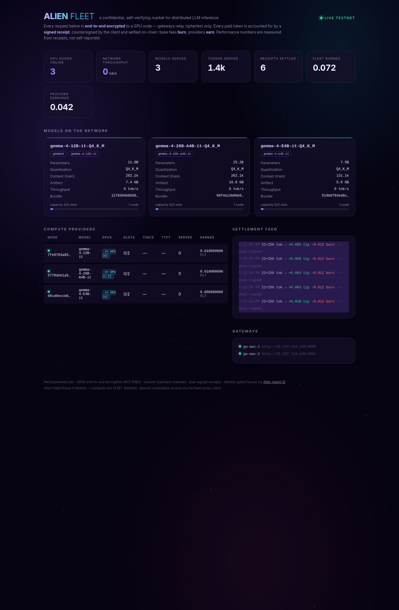

# Alien Fleet — Phase-0 testnet reference implementation

A working MVP of the [Alien Fleet whitepaper](alien-fleet-whitepaper-v1.0.md):
a permissionless market for LLM inference with end-to-end encrypted requests,
voucher payments, and signed receipts. Implemented in Go as **two single
binaries**, with llama.cpp as the inference backend. Deviations from the
paper are documented in the whitepaper's **Appendix A**.

**Live testnet**: dashboard at **https://fleet.lethe.gg** · gateway
entrypoints `http://15.237.243.199:9000` / `:9001` · three GPU providers
serving Gemma 4 (12B / 26B-A4B / E4B).

[](https://fleet.lethe.gg)

## Documentation

| Doc | What |
|---|---|
| [docs/BUILD.md](docs/BUILD.md) | building everything, configs, running each role |
| [docs/PROVIDER.md](docs/PROVIDER.md) | **connect your GPU to the testnet and earn** |
| [docs/DEPLOYMENT.md](docs/DEPLOYMENT.md) | control-plane deployment runbook (the live AWS setup) |
| [demo/aws/CLIENT.md](demo/aws/CLIENT.md) | run a client against the live testnet |
| [whitepaper](alien-fleet-whitepaper-v1.0.md) | the protocol; Appendix A = MVP deviations |

```
                                ┌────────────────────────────────────────────┐
 OpenAI client                  │ chain-sim (fleetd chain) — stands in for   │
 (any SDK / curl)               │ the L2: registry, PaymentHub, faucet,      │
      │ plain OpenAI HTTP       │ settlement, burns, bonds                   │
      ▼                         └─────▲──────────────▲───────────────▲───────┘
 ┌─────────────┐  HPKE-sealed    ┌────┴─────┐   ┌────┴─────┐         │ register/
 │ fleet-proxy  │  envelopes     │ gateway   │   │ gateway   │        │ beacon/settle
 │ session key, ├───────────────►│ gw-east   │   │ gw-west   │        │
 │ channel,     │  ciphertext    └────┬─────┘   └────┬─────┘         │
 │ receipts     │  only               │ relay        │ relay          │
 └─────────────┘                 ┌────▼─────┐  ┌─────▼────┐  ┌───────┴──┐
                                 │ node-a    │  │ node-b    │  │ node-c   │
                                 │ GPU 0     │  │ GPU 1+2   │  │ GPU 3    │
                                 │ gemma4    │  │ 26B-A4B   │  │ E4B      │
                                 │ (12B)     │  │ (split)   │  │          │
                                 └──────────┘  └──────────┘  └──────────┘
                                   llama.cpp llama-server, CUDA, per-node pinned
```

## What is implemented

- **§7 wire protocol**: deterministic-CBOR envelopes, RFC 9180 HPKE
  (X25519 / HKDF-SHA256 / ChaCha20-Poly1305), pad-to-bucket, encrypted
  response frame stream, signed **receipts** countersigned by the client.
- **Payments (AX2)**: faucet → payment channel → per-request signed
  **vouchers** (checked by the node *before* decryption) → settlement:
  base fee burned, tip to the node, earned-escrow bond (§8.1) held first.
- **Permissionless join (§8.1)**: any node registers, passes SHADOW,
  serves. Alias→bundle binding is TOFU (AX5); rebinding refused.
- **Identity (§13, Agent ID)**: the faucet trial credit is gated per
  verified owner via RFC 9449 DPoP + Alien SSO `at+jwt`; the ledger sees
  only a derived nullifier. `-dev-faucet` allows Phase-0 identityless claims.
- **Model & capacity discovery**: exact artifact names + GGUF metadata
  on-chain; `GET /v1/registry/capacity` (proxy: `/fleet/capacity`) reports
  nodes, slots, in-flight load, and TPS/TTFT measured from settled receipts.
- **Decentralized topology**: gateways are stateless relays seeing
  ciphertext only; run any number. The chain-sim is one process *simulating*
  the L2 — contracts API-compatible with §14.

## Quickstart

```bash
make build llama models      # Go binaries + llama.cpp (CUDA) + Gemma 4 bundles

# launch a local testnet: chain + 2 gateways + 3 GPU-pinned nodes
FRESH=1 ./demo/testnet.sh

# start the proxy and run the client demo (Agent ID optional)
AGENT_ID_CLI=~/agent-id/plugins/agent-id-auth/bin/cli.mjs ./demo/demo.sh

# point any OpenAI client at the proxy
curl http://127.0.0.1:8080/v1/chat/completions -H 'Content-Type: application/json' \
  -d '{"model":"gemma4","messages":[{"role":"user","content":"hello"}],"max_tokens":200}'
```

To join the **live** testnet as a provider instead, see
[docs/PROVIDER.md](docs/PROVIDER.md); as a client, see
[demo/aws/CLIENT.md](demo/aws/CLIENT.md).

`fleet-proxy` speaks plain OpenAI HTTP (`/v1/chat/completions` incl. SSE
streaming, `/v1/models`) and handles node selection (P2C ∝ S²/price),
sealing, payment, and receipt verification. Wallet/receipt view:
`GET /fleet/status`; network view: `GET /fleet/capacity`; chain view:
`GET <gateway>/v1/ledger/stats`.

## Layout

```
cmd/fleetd          one binary: `chain` | `gateway` | `node`
cmd/fleet-proxy     one binary: local OpenAI-compatible proxy
internal/wire       envelopes, HPKE, vouchers, receipts, frames (§7)
internal/ledger     chain-sim: accounts, channels, settlement, burns (§12)
internal/gateway    registry, capacity, relay, chain API (§8, §11, §14)
internal/node       Class O node: keys, llama.cpp, receipts (§6.5, §8)
internal/proxy      client engine: funding, sealing, verification (§11.1)
internal/identity   Agent ID DPoP verifier + nullifier (§13)
internal/llama      llama-server child process manager + GGUF metadata
demo/               testnet launcher, node configs, E2E demo script
```

## Trust model in one line

Plaintext exists only in the client process and the serving node
(Class O testnet); gateways and the chain see ciphertext, commitments,
and receipts — and every paid token is accounted for by a receipt that
both the node and the client signed.
